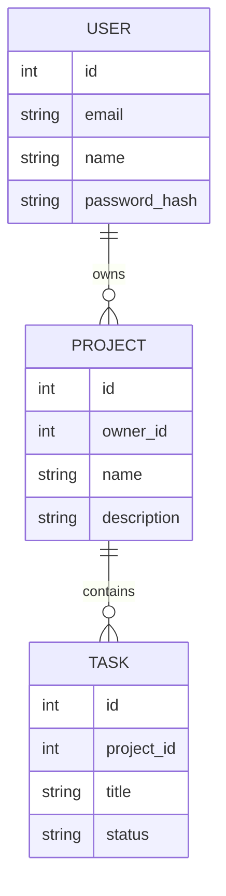

# 함께하는 할 일 보드

**분야:** AI/SW 기초 · 데이터베이스와 백엔드 · 선택 · 60시간
FastAPI 의존성 주입으로 로그인 인증과 보호 경로를 분리하고, 회원–프로젝트–할 일 관계와 완료 상태 전환을 구현한 서버 렌더링 웹 서비스입니다.

## 구현 기능

- 이메일/비밀번호 로그인 및 로그아웃, 로그인 상태를 반영하는 공통 내비게이션
- 로그인 필수 프로젝트·할 일 화면과 소유자별 데이터 접근 제어
- 프로젝트 생성·목록·상세, 프로젝트 내 할 일 등록·조회
- 진행 중 ↔ 완료 상태 전환 및 화면 결과 표시
- 존재하지 않거나 소유자가 아닌 프로젝트·할 일은 404 안내
- Jinja2 SSR, SQLAlchemy ORM, SQLite 저장

## 데이터 관계 및 구조



`User.projects`와 `Project.owner`, `Project.tasks`와 `Task.project`는 `back_populates`로 양방향 매핑됩니다. 사용자를 삭제하면 프로젝트와 작업이 함께 삭제되고, 프로젝트 삭제 시 그 작업만 삭제되도록 ORM의 `all, delete-orphan` 및 DB 외래 키 cascade를 설정했습니다. 작업 상태는 `in_progress` 또는 `completed`로 제한하며, 상태 전환은 서비스 계층에서 수행합니다.

```text
auth/          세션 기반 인증 의존성, 비밀번호 해싱
models/        User, Project, Task ORM 모델과 연관관계
repositories/  SQLAlchemy 데이터 접근
services/      인증, 소유권 확인, 프로젝트/작업 비즈니스 로직
routers/       로그인 및 보호된 프로젝트 요청 처리
templates/     홈, 로그인, 프로젝트 목록/상세/등록, 404 SSR 화면
tests/         관계형 데이터와 서비스 동작 검증
```

## 인증 및 접근 정책

Starlette 세션 미들웨어가 서명된 쿠키에 사용자 ID만 저장하고, 보호 요청마다 `Depends(get_current_user)`가 DB에서 회원을 다시 조회합니다. 비밀번호는 Python 표준 라이브러리의 PBKDF2-HMAC-SHA256으로 해시해 저장합니다. 서버 세션 방식은 FastAPI의 `Request`와 의존성 흐름으로 인증과 도메인 인가를 명확히 분리하고, 별도 JWT 의존성을 추가하지 않아도 되므로 선택했습니다.

| 경로 | 접근 | 동작 |
|---|---|---|
| `GET /` | 공개 | 서비스 소개, 로그인 상태에 따른 시작 링크 |
| `GET /login`, `POST /login` | 공개 | 로그인 폼 및 인증 |
| `POST /logout` | 공개 | 현재 세션 종료 |
| `GET /projects/` | 로그인 필수 | 내 프로젝트 목록 |
| `GET /projects/new`, `POST /projects/` | 로그인 필수 | 프로젝트 생성 |
| `GET /projects/{project_id}` | 로그인 필수·소유자 확인 | 프로젝트와 연관 작업 조회 |
| `POST /projects/{project_id}/tasks` | 로그인 필수·소유자 확인 | 작업 생성 |
| `POST /projects/{project_id}/tasks/{task_id}/toggle` | 로그인 필수·소유자 확인 | 작업 완료/진행 상태 전환 |

로그인하지 않은 사용자가 보호 경로에 접근하면 로그인 화면으로 303 리다이렉트됩니다. 다른 회원 소유의 프로젝트나 작업은 존재 여부를 노출하지 않도록 404로 처리합니다.

## 체험 계정

앱 시작 시 아래 계정을 데이터베이스에 생성합니다. 비밀번호는 평문으로 저장하지 않습니다.

| 이메일 | 비밀번호 |
|---|---|
| `alice@example.com` | `alice1234` |
| `bob@example.com` | `bob1234` |

각 계정에는 서로 분리된 예시 프로젝트가 생성됩니다. 프로젝트를 직접 추가하고, 그 안에서 할 일을 등록해 상태를 전환해 보세요.

## 개발 환경과 실행

- Python 3.10 이상
- FastAPI `>=0.115,<1.0`
- SQLAlchemy `>=2.0,<3.0`
- Uvicorn `>=0.30,<1.0`
- Jinja2 `>=3.1,<4.0`
- python-multipart `>=0.0.9,<1.0`
- itsdangerous `>=2.2,<3.0` (Starlette 서명 세션 쿠키)

```bash
python -m venv .venv
source .venv/bin/activate       # Windows: .venv\Scripts\activate
pip install -r requirements.txt
uvicorn main:app --reload
```

브라우저에서 [http://127.0.0.1:8000](http://127.0.0.1:8000)을 엽니다. SQLite 파일 `taskboard.db`와 테이블, 체험 계정은 최초 실행 시 자동으로 준비됩니다. `DATABASE_URL` 환경변수로 SQLAlchemy 연결 URL을 바꿀 수 있습니다.

운영 환경에서는 반드시 예측 불가능한 `SESSION_SECRET`을 환경변수로 지정하고 HTTPS에 맞춰 `COOKIE_HTTPS_ONLY=true`를 설정하세요. 기본 세션 키는 로컬 학습 전용입니다.

## 테스트

```bash
python -m unittest discover -s tests -v
```
